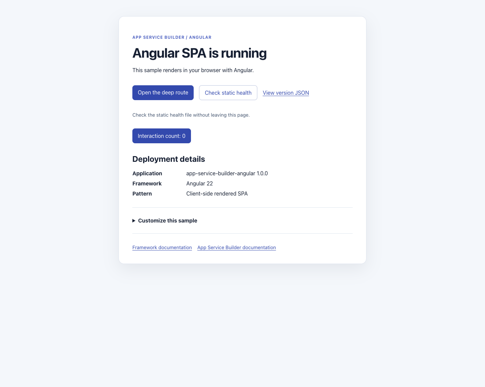

# App Service Builder: Angular sample

A standalone Angular single-page application with Angular Router for
[Azure App Service Builder](https://builder.appservice.azure.com/docs/). The
deployment consists only of static HTML, JavaScript, CSS, and JSON. There is
no backend, database, external service, or hosted Angular development server.

**App Service Builder is in Private Preview. Use this sample for development
and testing, not as a production application template.** The original sample
was successfully deployed with the included manifest and its tested links
worked. The renamed repository must still be deployed and verified in your
authorized preview environment. Local checks do not establish cloud deployment
success or regional availability.

## Sample preview



Rendered locally at `/` with the production build configuration and sample
settings. This screenshot is not evidence of an Azure deployment.

The starter UI lives at `/`. **Check static health** reads `/health.json` and
displays the result in place, including failures and retry guidance. A reachable
static file is not a backend health probe or Azure deployment status.
**Customize this sample** explains which files to edit in your fork; it does
not guess your repository or app URL. Framework and App Service Builder
documentation are labeled separately.

## Features

- Angular landing page with an interactive signal-based counter.
- Angular Router navigation, a nested product page, and a client-side not-found page.
- Static health and application identity JSON files.
- Hashed JavaScript and CSS assets built into `dist/spa-angular/browser/`.
- An explicit install/build/copy command for Builder's static deployment.
- Angular component and routing tests using the existing Vitest setup.

## Prerequisites

- [Node.js 24 LTS](https://nodejs.org/) (24.15.0 or newer) and npm 11 are recommended.
- [Git](https://git-scm.com/) and a GitHub account.
- For deployment: App Service Builder Private Preview access, an authorized
  Azure subscription, and an existing resource group in a supported preview
  location.
- Optional: [PowerShell 7](https://learn.microsoft.com/powershell/scripting/install/installing-powershell)
  for the endpoint verification script.

The lockfile contains Angular **22.2.4**, Angular CLI **22.2.5**, TypeScript
**6.0.3**, and Vitest **5.1.0**. Angular 22.2 requires TypeScript **>=6.0 <6.1**;
keep TypeScript within that range when updating dependencies. Keep
`package-lock.json` and use `npm ci` to install the locked versions rather than
updating dependencies during setup. Dependabot ignores TypeScript **>=6.1**
until Angular supports it; revisit that restriction when upgrading Angular.

## Run locally

Fork
[AzureAppService/app-service-builder-angular](https://github.com/AzureAppService/app-service-builder-angular/fork)
to your GitHub account. Clone your fork, replacing `<your-github-account>`:

```sh
git clone https://github.com/<your-github-account>/app-service-builder-angular.git
cd app-service-builder-angular
npm ci
npm start -- --host 127.0.0.1 --port 4200
```

Open `http://localhost:4200/`. Expect the heading `Angular SPA is running`.
Click **Interaction count: 0** and confirm it increments. Follow **Open the
deep route** to see `Widget 1`, then use **Return home**.

The development server is local only and is not the deployed runtime. Stop
it with Ctrl+C. If Angular reports the requested port is in use, stop your
own conflicting server or choose another port; check the URL printed by the CLI.

## Build and test

From the repository root:

```sh
npm test -- --watch=false
npm run build
```

Tests check application creation, public sample identity, the interactive
counter, the product route, and the unknown-route fallback. GitHub Actions
runs the tests and production build on Linux and Windows with Node.js 24.
The production build also checks TypeScript and Angular templates.

The Angular project retains its internal name `spa-angular`, so its browser
output remains `dist/spa-angular/browser/`. This intentionally preserves the
working deployment paths even though the repository and public sample identity
are now `app-service-builder-angular`.

To check production configuration locally:

```sh
npm start -- --configuration production --host 127.0.0.1 --port 8080
```

This command rebuilds using Angular's production configuration and serves it
through the local development server. It does not serve the previously
generated `dist/` directory and is not a production server to deploy.

With the local server running, optionally check the local or deployed URL
using PowerShell 7:

```powershell
pwsh -NoProfile -File .\scripts\verify.ps1 -BaseUrl http://localhost:8080
```

The script checks HTTP responses and the HTML shell; it does not execute
Angular. In a browser, also verify the counter, in-app navigation, direct
navigation to `/products/widget-1`, refreshing that route, and the unknown
route's `Page not found` heading.

## Routes and SPA fallback

| Route | Expected behavior |
|---|---|
| `/` | HTTP 200 shell; Angular renders the landing page and counter |
| `/products/widget-1` | HTTP 200 shell; Angular Router renders `Widget 1` |
| `/unknown-client-route` | HTTP 200 shell; Angular Router renders `Page not found` |
| `/health.json` | HTTP 200, static JSON with `"status": "ok"` |
| `/version.json` | HTTP 200, static application and framework metadata |
| Generated `.js` and `.css` files | Hashed browser assets loaded by the HTML shell |

This app uses the browser History API, not hash-based routing. Direct nested
links and refreshes require the deployed static host to return `index.html`
for client-side routes. Verify this behavior after deployment; a successful
root response alone is insufficient.

The unknown client route intentionally has HTTP status 200 when the host
returns the shell. Its not-found heading is rendered in the browser, not
returned as a server-side HTTP 404. The health file is a static asset, not a
running backend health probe.

## Deployment contract

The repository root contains `builder.yaml`:

```yaml
components:
  - name: site
    role: static
    platform: nodejs
    build: >-
      npm ci
      && npm run build
      && mkdir -p "$DESTINATION_DIR/dist/spa-angular/browser"
      && cp -r dist/spa-angular/browser/. "$DESTINATION_DIR/dist/spa-angular/browser/"
    output: dist/spa-angular/browser
    path: /
```

This declares one public static component at `/`. The source directory defaults
to the repository root. The custom build command installs locked dependencies,
builds the Angular application, and copies the browser output beneath Builder's
`$DESTINATION_DIR`. The destination directory is supplied by the build
environment; it is not a user-provided secret or an application setting.

The explicit dependency-install and copy steps are required: with a custom
build command, Oryx does not run its normal installation sequence, and the
generated files must be placed beneath the destination directory. The shell
commands run in Builder's Linux build environment, not Windows PowerShell.
Use `npm run build` alone for a normal local build.

Node.js is the build toolchain, not a deployed application server. Builder
publishes `dist/spa-angular/browser/`, not the source directory, all of `dist/`,
or `node_modules/`. No runtime port or start command is needed. Keep the
manifest at the repository root; the original deployment required it.

## Deploy your fork through Builder Portal

Follow the [Portal quickstart](https://builder.appservice.azure.com/docs/quickstarts/portal/)
for your authorized Private Preview environment:

1. Commit and push the sample to the `main` branch of your GitHub repository.
   Builder uses committed GitHub source, not local files.
2. Open Builder Portal and select your enabled subscription, existing resource
   group, and supported preview location.
3. Connect GitHub and authorize the Builder GitHub app to access your repository.
   Obtain organization-owner approval if required.
4. Create an app using your repository, branch `main`, and the repository root
   as its source directory. Do not select `src/`, `public/`, or `dist/`.
5. Explicitly start deployment and wait for a successful terminal status.
   Connecting a source or pushing a commit is not proof of deployment.
6. Open the returned runtime URL and verify the landing page, counter, generated
   assets, `/health.json`, and `/version.json`.
7. Open `/products/widget-1` directly and refresh it. Open an unknown client
   route and confirm Angular renders `Page not found`.

### Public configuration and updates

This sample does not read runtime environment variables or perform HTML
templating. Its application identity and health/version metadata are built
from the checked-in source and public files. Saving a Portal variable does
not substitute its value into the static bundle.

To update the sample, edit the application or public metadata, run the tests
and production build, commit, and push to your fork's `main` branch. Explicitly
deploy through Builder Portal, wait for completion, and verify the public pages
and deep links again. Automatic deployment on push is not qualified by this
sample. Never put credentials or private information in source or public assets.

### Cleanup

Delete only the Builder app you created and wait for deletion to complete.
Do not delete a shared resource group, subscription, or unrelated resources.
Deleting the app does not delete your GitHub repository or local clone.

## Resources and contributions

- [App Service Builder documentation](https://builder.appservice.azure.com/docs/)
- [Sample catalog](https://builder.appservice.azure.com/docs/samples/)
- [Manifest guide](https://builder.appservice.azure.com/docs/guides/builder-yaml/)
- [Contributing](CONTRIBUTING.md)
- [Code of Conduct](.github/CODE_OF_CONDUCT.md)
- [Security reporting](SECURITY.md)
- [Changelog](CHANGELOG.md)
- [MIT license](LICENSE.md)
